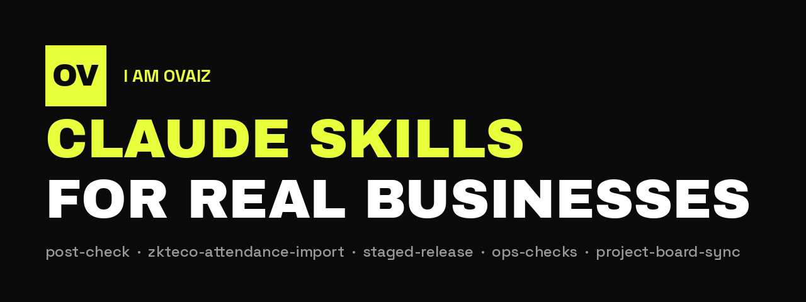

<p align="center">
  
</p>

<h1 align="center">Claude Skills for people who run real businesses</h1>

<p align="center">
  Five Claude Code skills taken from live business systems: a factory HR and payroll system, client online stores, and the release work behind them.<br>
  Each one exists because something broke without it.
</p>

<p align="center">
  <a href="LICENSE"></a>
  <a href="https://github.com/iamovaiz/claude-skills/actions/workflows/checks.yml"></a>
  
  
</p>

---

## Why these exist

I run business systems by directing Claude Code, not by writing every line myself. That works well until Claude does something reasonable that turns out to be wrong: a migration on the wrong database, a deploy that says READY while the site still serves last week's build, a night-shift worker marked absent because their shift crossed midnight.

Each skill below is the written-down fix for one of those. They are plain Markdown instructions plus small Python scripts with no dependencies, so you can read every line before you trust it.

## The skills

| Skill | Use it when | Script |
|---|---|---|
| [**post-check**](skills/post-check) | You are about to publish a LinkedIn or X post and want to catch em dashes, invisible characters, a leftover `,.`, placeholders, AI-sounding words and claims you ruled out | `postcheck.py` |
| [**zkteco-attendance-import**](skills/zkteco-attendance-import) | You have ZKTeco fingerprint-machine exports and need a monthly attendance sheet that gets night shifts right | `pair_shifts.py` |
| [**staged-release-supabase-vercel**](skills/staged-release-supabase-vercel) | You ship changes to a Supabase + Vercel app with separate staging and production, and want proof the live site serves the new version | `served_version.py` |
| [**supabase-vercel-ops-checks**](skills/supabase-vercel-ops-checks) | You set up a new Supabase project, run migrations remotely, or a deploy looks fine but the site is not | checklist |
| [**project-board-sync**](skills/project-board-sync) | You want Claude to read the project plan before working and suggest what is done, with evidence, when it stops | template |

## Install

**Claude Code**, all projects:

```bash
git clone https://github.com/iamovaiz/claude-skills.git
cp -r claude-skills/skills/post-check ~/.claude/skills/
```

Use `.claude/skills/` inside a repo instead to install for that project only. Claude picks a skill up from its description, so you don't need to call it by name.

**Claude apps** (web, desktop): download a skill's zip from the [latest release](https://github.com/iamovaiz/claude-skills/releases/latest) and upload it under Settings, Capabilities, Skills.

## Try one in a minute

```bash
cd claude-skills/skills/post-check
python3 postcheck.py examples/bad-post.txt --offlimits offlimits.example.txt
```

```
POST CHECK  linkedin, 166 chars, 4 hashtags
  FAIL  em dash: 1x
  FAIL  Unfilled placeholders: {{CTA}}
  FAIL  Off-limits: 500K revenue claim (not provable)
  FAIL  Banned words: game-changer, journey, thrilled to announce
  FAIL  Hashtags: 4 (max 3 for linkedin)
  ...
  RESULT  BLOCKED: fix every FAIL
```

## What the skills will and won't do

- They never publish, merge, deploy or run production SQL on their own. You approve each of those in chat.
- They never ask you to paste passwords, tokens or keys into the conversation.
- Every example file uses invented data. No real employees, clients or project IDs.
- The scripts use the Python standard library only (reading `.xlsx` needs `openpyxl`). Only `served_version.py` touches the network, and only the URL you give it.

## Contributing

Bug reports, fixes and new skills are welcome. Read [CONTRIBUTING.md](CONTRIBUTING.md) first; the main rule is that every skill comes from a real problem and ships with invented test data.

Found a security issue? See [SECURITY.md](SECURITY.md) and report it privately.

## License

Apache License 2.0. See [LICENSE](LICENSE) and [NOTICE](NOTICE). You can use, change and redistribute these skills, including commercially. Keep the LICENSE and NOTICE files with any copy.

The license covers the code and text in this repo. It does not give permission to use the "I AM OVAIZ" name, the OV logo or other I AM OVAIZ branding, except to say where the skills came from.

---

<p align="center">
  Made by <a href="https://iamovaiz.com"><b>I AM OVAIZ</b></a>. We build business systems for factories, retailers and e-commerce operators.<br>
  If a skill saved you time, a star helps other people find it.
</p>
